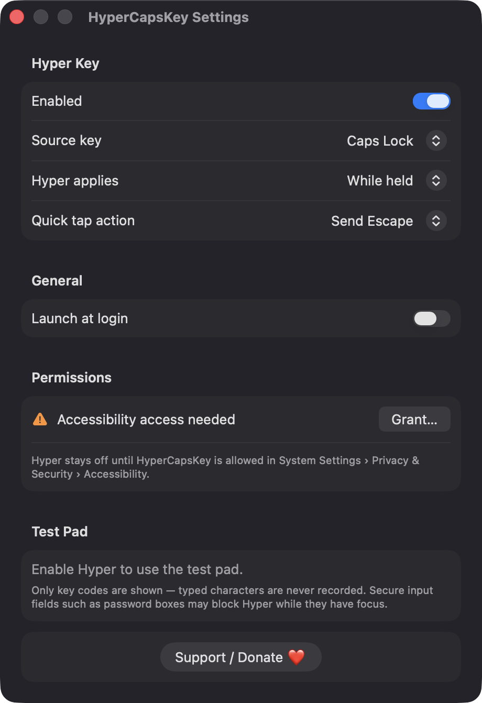
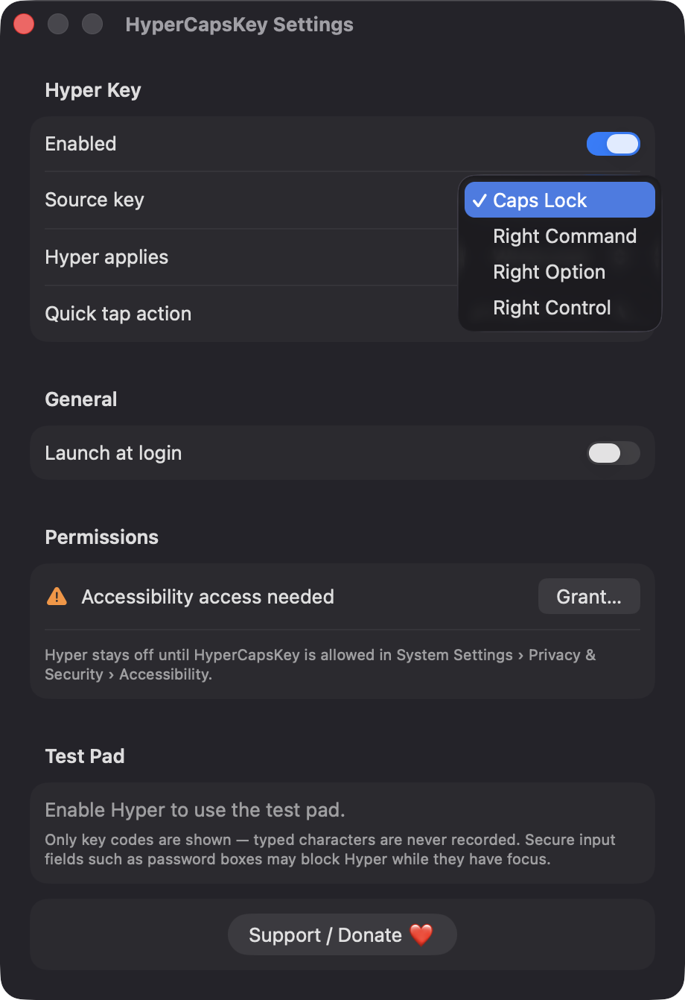
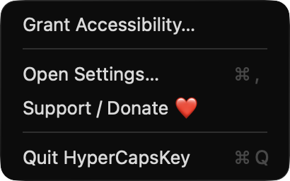

# HyperCapsKey

**🌐 Website:** [turhe123.github.io/hyper-caps-key](https://turhe123.github.io/hyper-caps-key/)

Turn Caps Lock into a Hyper key that fires Command, Option, Control and Shift together for your shortcuts.


## Why

HyperCapsKey is a free, open-source, 100% native, backend-free alternative to paid utilities in the *Text & Input* category. It was inspired by Hyperkey ($19 one-time), which popularised the idea of a Hyper modifier for conflict-free global shortcuts. HyperCapsKey covers the same core idea with no account, no server and no dependencies beyond Apple's own frameworks.

## Features

- **Hyper key**: while the source key is held, every other key press is delivered with Command, Option, Control and Shift all added.
- **Choice of source key**: Caps Lock, Right Command, Right Option or Right Control.
- **Caps Lock remapping**: Caps Lock is remapped to F18 on all connected keyboards using the same `UserKeyMapping` property that `hidutil` manages, so the event tap can see it reliably. Any mapping you already had is saved and put back.
- **Fallback**: if Caps Lock can't be remapped, Right Command acts as Hyper instead, and Settings tells you.
- **Hold or latch**: apply Hyper only while held, or let a quick tap arm it for the next key press.
- **Quick tap action**: a tap with no other key can send Escape or do nothing. Key repeat doesn't re-trigger it.
- **Menu bar app**: a keyboard icon that fills while Hyper is active. The menu has an Enabled toggle, the quick tap action, Settings, a support link and Quit.
- **Test pad** in Settings: shows the last event type, key code and modifier flags. It records only key codes, never typed characters, and clears when closed.
- **Launch at login** through `SMAppService`.
- **Robust**: the event tap is re-enabled if the system disables it, the mapping is reapplied after wake, and it is removed on quit, on disable, and at the next launch if a previous run crashed.
- **Accessibility prompt shown once**: with no permission, the menu shows only "Grant Accessibility…" and the remap stays off.

## Screenshots

<p align="center"></p>

<p align="center"><em>The HyperCapsKey Settings window: turn the Hyper key on, pick the source key, choose hold or latch, and set what a quick tap does.</em></p>

<p align="center"></p>

<p align="center"><em>Choose which key becomes Hyper: Caps Lock, Right Command, Right Option or Right Control.</em></p>

<p align="center"></p>

<p align="center"><em>The menu bar menu before Accessibility is granted, with a shortcut to grant it, Settings, a Support link and Quit.</em></p>

## Install

1. Download `HyperCapsKey-macOS.zip` from the [latest release](https://github.com/turhe123/hyper-caps-key/releases/latest).
2. Unzip it and move `HyperCapsKey.app` to `/Applications`.
3. Because the app is open source and not notarized, clear the quarantine flag:

   ```bash
   xattr -cr /Applications/HyperCapsKey.app
   ```

4. Right-click the app and choose **Open** the first time.

## Build from source

Requires Xcode with macOS 14+ SDK.

```bash
brew install xcodegen
xcodegen generate
xcodebuild -project HyperCapsKey.xcodeproj -scheme HyperCapsKey -configuration Release -derivedDataPath ./build build
```

The app is produced at `build/Build/Products/Release/HyperCapsKey.app`.

## Permissions

- **Accessibility** (required): needed to create the session-level event tap that adds the Hyper modifiers to key events and to post the Escape key on a quick tap. Grant it in System Settings › Privacy & Security › Accessibility.
- **Login item** (optional): only if you turn on "Launch at login".

HyperCapsKey does not request Screen Recording, Microphone, Camera, Contacts or any other permission, and makes no network connections. It runs `/usr/bin/hidutil` locally to set and restore the Caps Lock mapping. Secure input fields such as password boxes may block event taps while they have focus.

## Built with AI

HyperCapsKey was written by [Claude Code](https://claude.com/claude-code) inside an automated pipeline, from a plain-English spec. No code, binaries or assets from any commercial app were used; it is a clean-room reimplementation of a feature set, not a copy.

What that means in practice:

- The full source is in this repo under the MIT license. Read it before you run it.
- No network calls, no analytics, no third-party dependencies. Only Apple frameworks.
- Ad-hoc signed and not notarized, which is why Gatekeeper warns on first launch.
- It has had less human review than a hand-written app. Bug reports and pull requests are welcome.

## Support ❤️

If HyperCapsKey is useful to you, you can support its development: [Support Or (Leo) Davidai ❤️](https://ko-fi.com/leodavidai)

## License

MIT © Or Davidai Bachar

## More free Mac apps

Prefer something that runs in the browser? The same pipeline builds [free, private web tools](https://turhe123.github.io/web-tools/): PDF, image, developer, data and audio tools, nothing uploaded.
